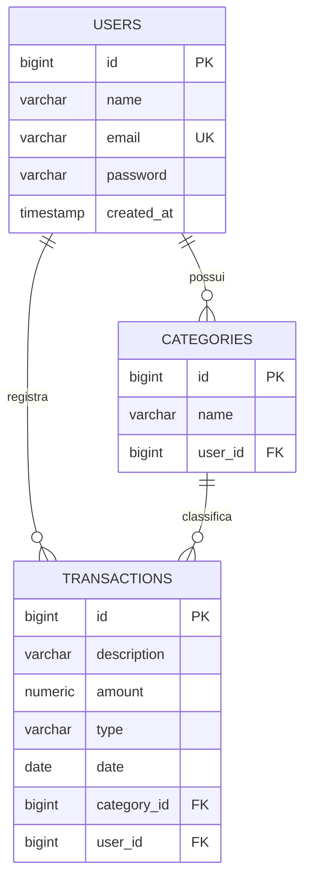

# FinTrack API

[](https://github.com/gHNocera/fintrack/actions/workflows/ci.yml)


API REST de **finanças pessoais**: cadastre categorias, registre receitas e despesas, filtre por período e veja o resumo do mês. Cada usuário acessa **apenas os próprios dados**.


## Por que este projeto

Quis reunir em um único sistema o que uma API de backend precisa ter além do CRUD: autenticação, regras de negócio, banco versionado, testes automáticos, documentação, containerização e integração contínua. O domínio (finanças pessoais) é simples de entender, o que deixa o foco nas decisões técnicas.

## Funcionalidades

- Cadastro e login de usuários, com autenticação **JWT stateless**
- CRUD de **categorias** (nome único por usuário)
- CRUD de **transações** (receita ou despesa, valor, data, descrição, categoria)
- Listagem com **filtros** (período, categoria, tipo) e **paginação**
- **Resumo mensal**: total de receitas, despesas, saldo e gasto por categoria
- **Isolamento total entre usuários**: ninguém lê ou altera dados de outra pessoa
- Erros padronizados em JSON, com o status HTTP correto

## Tecnologias

| Área | Tecnologia |
|---|---|
| Linguagem / Framework | Java 21, Spring Boot 4, Spring Web MVC |
| Persistência | Spring Data JPA (Hibernate), PostgreSQL 16 |
| Migrations | Flyway |
| Segurança | Spring Security, JWT (JJWT), BCrypt |
| Validação | Jakarta Bean Validation |
| Documentação | OpenAPI / Swagger UI (springdoc) |
| Testes | JUnit 5, Mockito, AssertJ, MockMvc, Testcontainers, JaCoCo |
| Infraestrutura | Docker, Docker Compose, GitHub Actions |

## Como executar

### Com Docker (recomendado)

Pré-requisito: Docker.

```bash
git clone https://github.com/gHNocera/fintrack.git
cd fintrack
cp .env.example .env
# edite o .env e defina JWT_SECRET (o arquivo explica como gerar a chave)
docker compose up --build
```

A API sobe em `http://localhost:8080` e a documentação em **http://localhost:8080/swagger-ui.html**.

### Desenvolvimento local

Pré-requisitos: JDK 21 e Docker (para o banco).

```bash
docker compose up -d db
export JWT_SECRET="sua-chave-base64"   # PowerShell: $env:JWT_SECRET="sua-chave-base64"
./mvnw spring-boot:run
```

## Testes

```bash
./mvnw verify
```

Roda os testes unitários (services e JWT, com Mockito) e os de **integração** (API completa com um PostgreSQL real em container, via Testcontainers). O Docker precisa estar em execução. O relatório de cobertura fica em `target/site/jacoco/index.html`.

O CI executa o mesmo comando a cada push.

## Endpoints

Rotas marcadas com 🔒 exigem o cabeçalho `Authorization: Bearer <token>`.

| Método | Rota | Descrição |
|---|---|---|
| POST | `/auth/register` | Cadastra um usuário |
| POST | `/auth/login` | Autentica e devolve o token JWT |
| POST | `/categories` 🔒 | Cria categoria |
| GET | `/categories` 🔒 | Lista as categorias do usuário |
| GET | `/categories/{id}` 🔒 | Busca uma categoria |
| PUT | `/categories/{id}` 🔒 | Atualiza uma categoria |
| DELETE | `/categories/{id}` 🔒 | Remove (bloqueado se houver transações) |
| POST | `/transactions` 🔒 | Cria transação |
| GET | `/transactions` 🔒 | Lista com filtros e paginação |
| GET | `/transactions/{id}` 🔒 | Busca uma transação |
| PUT | `/transactions/{id}` 🔒 | Atualiza uma transação |
| DELETE | `/transactions/{id}` 🔒 | Remove uma transação |
| GET | `/summary?month=AAAA-MM` 🔒 | Resumo do mês |

Filtros de `GET /transactions` (todos opcionais): `from`, `to` (AAAA-MM-DD), `categoryId`, `type` (`INCOME` ou `EXPENSE`), `page` (começa em 0) e `size` (máximo 100). O resultado vem da data mais recente para a mais antiga.

### Exemplo de uso

```bash
# 1. Cadastro e login
curl -X POST http://localhost:8080/auth/register -H "Content-Type: application/json" \
  -d '{"name":"Gabriel","email":"gabriel@exemplo.com","password":"senha12345"}'

curl -X POST http://localhost:8080/auth/login -H "Content-Type: application/json" \
  -d '{"email":"gabriel@exemplo.com","password":"senha12345"}'
# resposta: {"accessToken":"...","tokenType":"Bearer","expiresInSeconds":3600}

TOKEN="cole-o-accessToken-aqui"

# 2. Criar uma categoria e uma despesa
curl -X POST http://localhost:8080/categories -H "Authorization: Bearer $TOKEN" \
  -H "Content-Type: application/json" -d '{"name":"Alimentacao"}'

curl -X POST http://localhost:8080/transactions -H "Authorization: Bearer $TOKEN" \
  -H "Content-Type: application/json" \
  -d '{"description":"Almoco","amount":35.50,"type":"EXPENSE","date":"2026-12-10","categoryId":1}'

# 3. Resumo do mês
curl "http://localhost:8080/summary?month=2026-12" -H "Authorization: Bearer $TOKEN"
```

Resposta do resumo:

```json
{
  "month": "2026-12",
  "totalIncome": 0.00,
  "totalExpense": 35.50,
  "balance": -35.50,
  "expensesByCategory": [
    { "category": "Alimentacao", "total": 35.50 }
  ]
}
```

## Modelo de dados



O esquema é criado e versionado pelo Flyway (`src/main/resources/db/migration`). Há restrições no próprio banco (`UNIQUE`, `NOT NULL`, `CHECK (amount > 0)`, chaves estrangeiras) e um índice em `(user_id, date)` para as consultas de listagem e resumo.

## Arquitetura

```
Controller  →  Service  →  Repository  →  PostgreSQL
 (HTTP/DTO)    (regras)     (acesso a dados)
```

```
com.ghartmann.fintrack
├── config/       configuração de segurança e OpenAPI
├── controller/   endpoints REST
├── service/      regras de negócio
├── repository/   Spring Data JPA, Specifications e consultas JPQL
├── domain/       entidades JPA e enums
├── dto/          objetos de entrada e saída (records)
├── security/     JWT, filtro de autenticação e UserDetails
└── exception/    exceções e tratamento global de erros
```

## Decisões técnicas

- **Flyway cria o esquema e o Hibernate só valida** (`ddl-auto: validate`). O banco evolui por migrations versionadas, reproduzíveis em qualquer ambiente.
- **`BigDecimal` para dinheiro**, mapeado em `NUMERIC(12,2)`. `double` acumula erros de arredondamento.
- **DTOs em vez de entidades na API**: evita vazar dados internos (como a senha) e desacopla o contrato da API do modelo de banco.
- **Isolamento por usuário na própria consulta** (`findByIdAndUserId`, filtros por dono nas Specifications e no JPQL). Dados de outro usuário respondem `404`, sem revelar que existem. Isso previne IDOR, e é coberto por testes automatizados.
- **JWT stateless**: sem sessão no servidor. O id do usuário vem sempre do token, nunca do corpo da requisição. A chave de assinatura fica em variável de ambiente.
- **Senhas com BCrypt**, e a mesma mensagem de erro para e-mail inexistente e senha errada, para não revelar quais e-mails existem.
- **Filtros opcionais com `Specification`**, para montar o `WHERE` só com o que foi informado.
- **Paginação com limite no servidor** (`size` máximo 100) e `@EntityGraph` para evitar o problema N+1.
- **Resumo calculado no banco** (`SUM` + `GROUP BY` em JPQL), em vez de trazer as linhas para somar em Java.
- **Testes de integração com PostgreSQL real** (Testcontainers), e não H2, para validar migrations e consultas no mesmo banco de produção.
- **Dockerfile multi-stage**: imagem final só com o JRE e o jar, rodando com usuário sem privilégios.
- **Erros padronizados** com `@RestControllerAdvice`: 400, 401, 404 e 409 com o mesmo formato JSON.

## Próximos passos

- Refresh token e revogação de tokens
- Spring Boot Actuator (health check e métricas)
- Perfis de acesso (roles) e limite de requisições (rate limiting)
- Deploy em nuvem

## Autor

**Gabriel**

- GitHub: [@gHNocera](https://github.com/gHNocera)
- LinkedIn: [gabriel-hartmann](https://www.linkedin.com/in/gabriel-hartmann-735ab5296/)